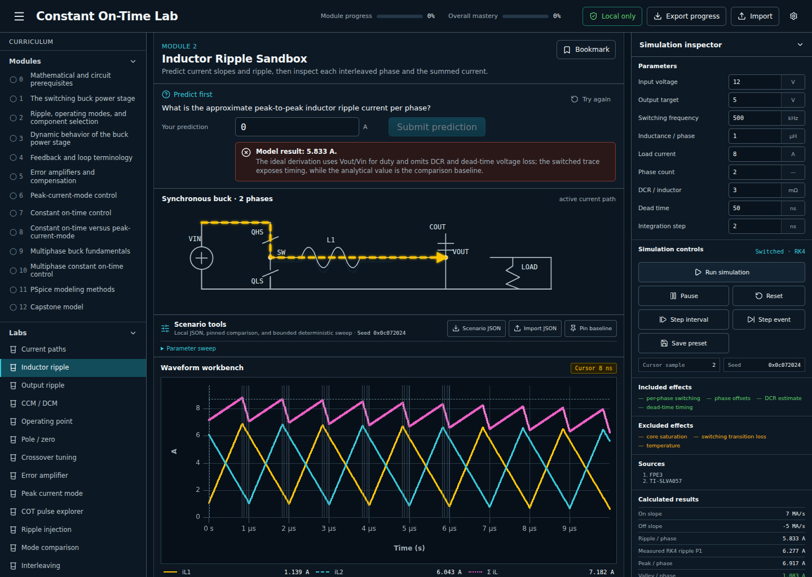

# Constant On-Time Lab

Constant On-Time Lab is a local-first, offline-capable learning and modeling environment for buck converters, control loops, constant on-time control, multiphase scheduling, and PSpice behavioral modeling. It combines a 13-module curriculum, 17 engineering labs, a deterministic TypeScript simulation core, a 43-source research library, and a progressive plain-text PSpice ladder.



## Verified project status

- Local application, production build, offline runtime, curriculum, source library, simulations, unit tests, and documentation: **implemented and locally verified**. The final Playwright matrix completed with 33 passes, 17 intentional project skips, and no failures; see [HANDOFF.md](HANDOFF.md).
- Cadence PSpice execution: **not run** because PSpice and a license were unavailable. Structural and analytical checks pass; see [validation status](pspice/validation-status.md).
- GitHub publication: **not completed**. No git remote is configured, so private visibility, push, pull request, remote Actions, and merge have not been verified. No public fallback exists. See [HANDOFF.md](HANDOFF.md) for the exact publication state.

## Start locally

Requirements: Node.js 22 or newer, npm 10 or newer, and Python 3 for the PSpice static checks.

```bash
git switch agent/initial-build
npm ci
npm run dev
```

Open <http://127.0.0.1:5173>. No account, backend, telemetry, database, hosted analytics, external AI service, or internet connection is used during normal operation.

For the production/offline build:

```bash
npm run build
npm run check:offline
npm run preview
```

Open <http://127.0.0.1:4173>. The installed production shell and curriculum are precached for offline use.

## Learning path

The curriculum contains Modules 0–12 and 49 structured lessons. Every lesson separates physical intuition, mathematical derivation, and modeling consequence, then connects the concept to prediction, simulation, transfer, and PSpice decisions.

Begin with [START_HERE.md](docs/START_HERE.md): **Module 1, Lesson 1.1, “Two switch states, one inductor,” followed by `MIT622-L05`, David J. Perreault’s “Lecture 5: Intro to DC/DC, Part 1.”** Module 0 is a diagnostic prerequisite gate, not mandatory review for material you can already demonstrate.

Key study aids include the [formula sheet](docs/FORMULA_SHEET.md), [control-mode taxonomy](docs/CONTROL_MODE_TAXONOMY.md), [misconception guide](docs/COMMON_MISCONCEPTIONS.md), [concept map](docs/CONCEPT_MAP.md), [PSpice modeling guide](docs/PSPICE_MODELING_GUIDE.md), [debugging guide](docs/PSPICE_DEBUGGING_GUIDE.md), and [capstone guide](docs/CAPSTONE_GUIDE.md).

## Interactive laboratories

The application provides scoped educational implementations of all 17 named experiences. They share a serious lab workflow, but the normalized control-comparison and debugging cases, averaged current-sharing model, and generic COT/scheduler policies remain intentionally simpler than controller-vendor or transistor-level models; the exact gaps are recorded in `HANDOFF.md`.

1. Current-Path Puzzle
2. Inductor Ripple Sandbox
3. Capacitor and Output-Ripple Sandbox
4. CCM/DCM Waveform Identification
5. Buck Operating-Point Designer
6. Pole-and-Zero Explorer
7. Crossover-Frequency Tuning Lab
8. Error-Amplifier Builder
9. Peak-Current-Mode Pulse Simulator
10. Constant On-Time Pulse Simulator
11. Constant On-Time Ripple-Injection Challenge
12. Control-Mode Comparison Lab
13. Multiphase Interleaving Visualizer
14. Multiphase COT Scheduler Simulator
15. Current-Sharing Challenge
16. PSpice Block-Construction Puzzle
17. Broken-Model Debugging Laboratory

Each lab exposes its abstraction, governing equation, assumptions, included/excluded effects, numerical limitations, and real source IDs. Generic COT and scheduler blocks are explicitly educational architectures, not replicas of every commercial controller.

Common tools include predict-before-reveal, run/pause/reset, interval and event stepping, waveform cursors, zoom and pan, CSV and plot-image export, strict per-lab scenario JSON, pinned side-by-side comparison, bounded worker-based parameter sweeps, deterministic seeds, and locally saved presets.

## Numerical engine

[`@constant-on-time/sim-core`](packages/sim-core/README.md) is UI-independent and tested directly. It includes:

- event-aligned fixed-step RK4 switched N-phase plant evolution;
- high-side, low-side, dead-time, and body-diode conduction with reverse-current sign handling;
- capacitor KCL, ESR algebraic output solve, and a disclosed output-only ESL approximation;
- resistive, constant-current, and stepped loads;
- COT one-shot, timing limits, hysteresis, delay, ripple injection, and current limit;
- simplified sampled-data peak-current cycles and slope-compensation analysis;
- fixed-spacing, first-eligible, round-robin, minimum-separation, current-priority, and free-running scheduler policies;
- current-sharing control, seeded mismatch/noise, engineering units, Bode/loop models, diagnostics, and versioned engine scenarios.

The engine tests analytical conversion, slopes, ripple, volt-second balance, charge balance, conduction modes, event alignment, interleaving, scheduling fairness, timing limits, COT behavior, peak-current behavior, current sharing, serialization, and deterministic randomness. Averaged, switched, sampled-data, and behavioral results are labeled separately.

## PSpice ladder

The [`pspice/`](pspice/README.md) directory has seven inspectable libraries, 21 focused/capstone decks, a deterministic 2–8-phase generator, structural lint, analytical checks, and a browser-to-PSpice block mapping. It progresses from averaged and switched buck stages through voltage mode, peak current mode, single/two/N-phase COT, balancing, phase shedding, and capstone transients.

Run the checks that do not require Cadence:

```bash
python3 pspice/scripts/netlist_lint.py
python3 pspice/scripts/analytical_checks.py
```

Passing those commands does **not** establish PSpice parser or runtime compatibility. The exact remaining compatibility risks and first-run protocol are preserved in [pspice/validation-status.md](pspice/validation-status.md).

## Research library

The source library catalogs 43 public technical sources across 21 required topic tags. The [15-source core reading path](docs/sources/core-reading-path.md) is the shortest rigorous route; the [annotated bibliography](docs/sources/annotated-bibliography.md), [comparison](docs/sources/source-comparison.md), and [research gaps](docs/sources/research-gaps.md) provide broader coverage. Machine-readable metadata is in [`sources/manifest.json`](sources/manifest.json) and [`sources/bibliography.csv`](sources/bibliography.csv).

Original summaries and stable citation IDs are stored rather than copied books or application notes. Project content is intentionally limited to public sources, generic parameters, and synthetic examples; the local secret-pattern scan passes. No employer, customer, restricted-model, or proprietary material was intentionally added.

## Verification

```bash
npm run lint
npm run typecheck
npm test
npm run verify:static
npm run build
npm run check:offline
npm run test:e2e
npm run check:links
npm audit --audit-level=high
```

Local GitHub Actions workflow files are configured to run linting, type checking, unit/coverage tests, production/offline build checks, browser/accessibility/visual tests, source-link checks, secret/generated-artifact scans, and dependency auditing after publication. Locally, 154 unit/regression tests pass, the 50-case Playwright matrix reports 33 passes plus 17 intentional tablet-project skips, all 43 source links were checked, and the dependency audit reports zero vulnerabilities. No remote workflow run exists yet.

The architecture, visual system, limitations, and exact handoff are documented in [ARCHITECTURE.md](ARCHITECTURE.md), [DESIGN.md](DESIGN.md), and [HANDOFF.md](HANDOFF.md).
