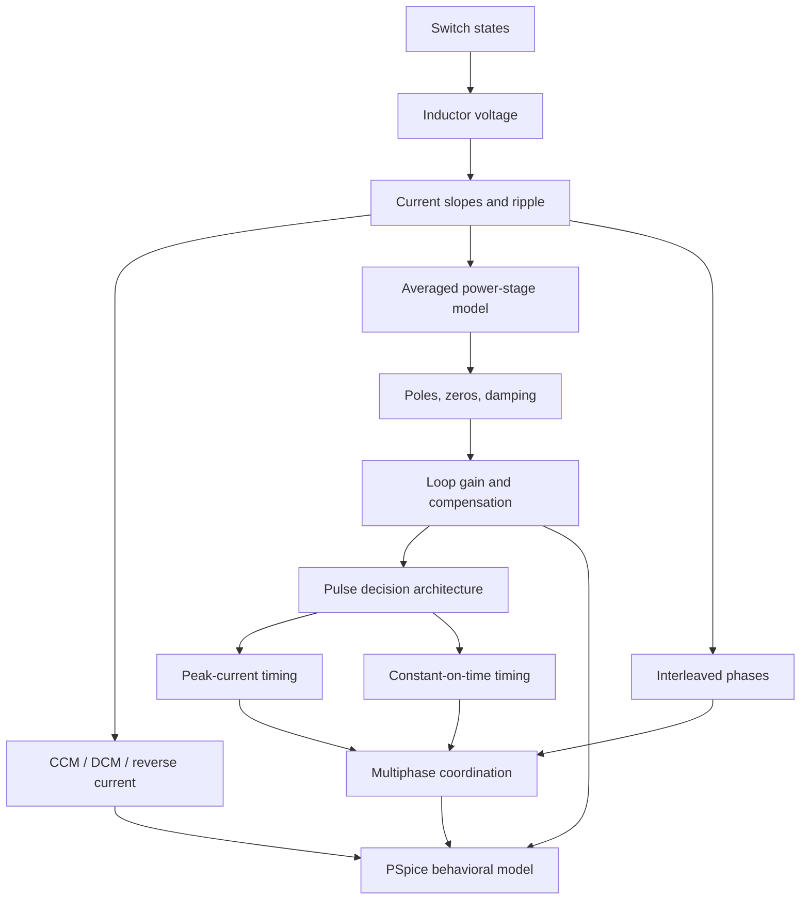

# Concept map

## The three questions behind every block

1. **Physics:** Which voltage or current causes the state to change?
2. **Mathematics:** Which differential equation, constraint, or sampled event represents it?
3. **Modeling:** Which effects are included, excluded, or approximated, and what test could falsify the block?

## Causal chain

- Switch commands set the switch node.
- The switch node and output voltage set inductor voltage.
- Inductor voltage sets current slope; the sum of phase currents minus load current sets capacitor current.
- Energy storage and dissipation set the plant response.
- The controller observes selected signals and decides when another switch state begins.
- In multiphase systems, a scheduler or coupling rule modifies which phase receives a pulse.
- PSpice represents each link at an explicit abstraction; convergence is not evidence that the links are physically right.

Sources: `MIT622-L05`, `FPE3`, `TI-SLVA301`, `KAPAT-2020`, `TI-SLVA882`, `CAD-PSPICE-UG`.

