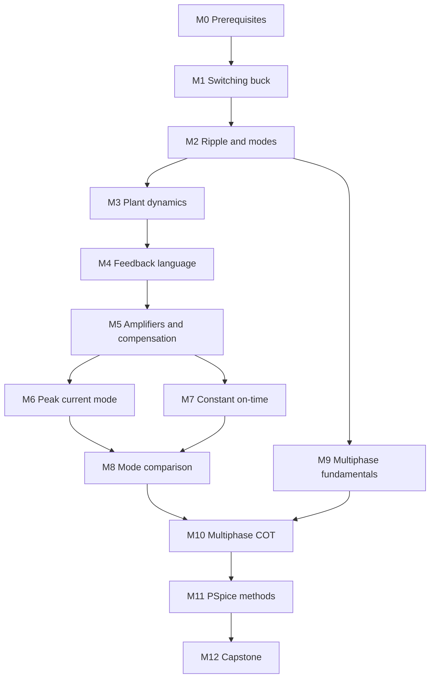

# Curriculum

## Dependency path

Each major idea is taught as **physical intuition → mathematical derivation → modeling consequence**. The structured application content is in `packages/lesson-content/modules.json`.

## Module 0 — Mathematical and circuit prerequisites

- **Question:** Can you move between waveforms, differential equations, transfer functions, and Bode plots without losing units or sign?
- **Lessons:** state variables; (L,di/dt) and (C,dv/dt); complex impedance; Laplace/poles/zeros; decibels; feedback algebra; basic numerical integration.
- **Diagnostic gate:** derive the response of first-order RL and RC circuits, identify a pole from a denominator, convert a ratio to dB, and explain Euler-step error.
- **Interaction:** prerequisite diagnostic and pole/zero quick checks.
- **Sources:** `FPE3`.

## Module 1 — The switching buck power stage

- **Question:** Where does current physically flow in every conduction and dead-time state?
- **Lessons:** asynchronous and synchronous switch states; inductor voltage; capacitor current; volt-second and charge balance; duty ratio; body diode; reverse current.
- **Interaction:** current-path puzzle with polarity and dead-time variants.
- **Transfer gate:** predict the current path when dead time begins with negative inductor current.
- **Sources:** `MIT622-L05`, `TI-SLVA057`, `FPE3`.

## Module 2 — Ripple, modes, and component selection

- **Question:** How do slopes, ripple, load, and nonidealities determine CCM, DCM, stress, and transient energy?
- **Lessons:** ripple derivation; peak/valley; capacitor/ESR/ESL ripple; CCM/DCM/boundary/reverse current; DCR/RDS(on)/diode/dead-time effects; load-step charge deficit.
- **Interactions:** ripple sandbox, capacitor sandbox, waveform identification, operating-point designer.
- **Transfer gate:** choose L and C for two defensible designs and explain the trade.
- **Sources:** `MIT622-L07`, `MIT622-L08`, `TI-SLVA057`, `TI-SLVA477`, `ADI-BUCK-EQ`, `ADI-AN1144`.

## Module 3 — Dynamic behavior of the buck power stage

- **Question:** What changes when a periodic converter is perturbed, and what does averaging erase?
- **Lessons:** energy exchange and LC resonance; damping/load dependence; control-to-output, line-to-output, and output impedance; perturbation/linearization; averaged versus switched models.
- **Interaction:** pole-and-zero explorer, model-abstraction comparison.
- **Transfer gate:** predict how reducing load current changes damping before viewing the Bode plot.
- **Sources:** `FPE3`, `TI-SLVA057`, `VORPERIAN-CCM`, `VORPERIAN-DCM`.

## Module 4 — Feedback and loop terminology

- **Question:** Which response or loop does each “bandwidth” and “phase” statement actually name?
- **Lessons:** open/closed loop; return ratio; crossover; phase/gain margin; peaking/damping; switching-frequency separation; disambiguation of power phase, phase offset, Bode phase, phase margin, and multiple loop bandwidths.
- **Interaction:** terminology sorter and Bode/time-domain matching lab.
- **Transfer gate:** reject or repair five ambiguous claims containing “buck bandwidth.”
- **Sources:** `FPE3`, `MIDDLEBROOK-1975`, `BROWN-1981`.

## Module 5 — Error amplifiers and compensation

- **Question:** How do reference, divider, amplifier, modulator, plant, and sensing combine into total loop gain?
- **Lessons:** op-amp/transconductance error amplifiers; Type I/II/III; component-to-pole/zero mapping; DC accuracy; high-frequency rolloff; injection and measured/model differences.
- **Interactions:** error-amplifier builder and crossover tuning lab.
- **Transfer gate:** include modulator and feedback gain in a loop design and explain the injection point.
- **Sources:** `FPE3`, `TI-SLVA301`, `MIDDLEBROOK-1975`.

## Module 6 — Peak-current-mode control

- **Question:** How does a sampled current crossing turn into a pulse width, and when do cycle perturbations grow?
- **Lessons:** clock set/current reset; current-sense and artificial ramps; slope compensation; sampled-data effects; blanking/delay/min-times; current limit; peak versus valley control; low-frequency simplification and its limits.
- **Interaction:** peak-current pulse simulator with alternating-cycle and slope-compensation exercises.
- **Transfer gate:** predict whether a ramp change damps or amplifies a two-cycle perturbation and state the assumed model.
- **Sources:** `MIT622-L27`, `TI-SNVA555`, `TI-SLVAE22`, `RIDLEY-1991`, `TAN-MIDDLEBROOK-1995`.

## Module 7 — Constant on-time control

- **Question:** What starts the pulse, what ends it, and what signal makes the next crossing well behaved?
- **Lessons:** fixed/adaptive on-time; one-shot and variable off-time; comparator ripple; natural and synthetic ripple; delay/hysteresis/noise; frequency variation; min/max timing; light-load modes; servo/error-amplifier variants.
- **Interactions:** COT pulse simulator and ripple-injection challenge.
- **Transfer gate:** diagnose jitter from insufficient ripple and distinguish amplitude, phase, delay, and timestep causes.
- **Sources:** `TI-SLVA281`, `TI-SLVA453`, `TI-SNVA166`, `TI-SNVA874`, `TI-SLVA546`, `LIU-COT-2023`, `SUN-COT-2019`, `ON-FAN23SV10M`.

## Module 8 — COT versus peak-current-mode

- **Question:** Which labels describe timing, which describe sensed state and loop action, and where do hybrids fit?
- **Lessons:** pulse-start/end matrix; variable/fixed frequency; outer/inner loops; sensing, limiting, noise, light load, delays, and model complexity; hybrid architectures.
- **Interaction:** identical-plant control-mode comparison.
- **Transfer gate:** classify a current-programmed constant-on-time controller without forcing it into one exclusive box.
- **Sources:** `KAPAT-2020`, `RIDLEY-1990-COT`, `TI-SLVA281`.

## Module 9 — Multiphase buck fundamentals

- **Question:** What cancels through timing, and what still requires sensing and correction?
- **Lessons:** phase-current sum; interleaving and effective ripple frequency; input/output ripple; RMS/thermal split; mismatch; static/dynamic sharing; shedding; current-slew and capacitor implications.
- **Interaction:** 2–8 phase interleaving visualizer.
- **Transfer gate:** predict ripple and sharing separately for ideal spacing with 10% inductance mismatch.
- **Sources:** `TI-SLVA882`, `TI-SLYT139`, `TI-SSZTC61`, `INFINEON-DUALPHASE`.

## Module 10 — Multiphase COT

- **Question:** How can variable-timing phases request, receive, delay, or lose pulses without collision or starvation?
- **Lessons:** free-running versus coordinated phases; locking/scheduling; collisions, bunching, beats, starvation; minimum separation; current-priority/fairness; balance loops; shedding/re-entry; large-step allocation.
- **Interactions:** multiphase COT scheduler and current-sharing challenge.
- **Transfer gate:** compare round-robin and current-priority schedules under a mismatched phase, including fairness and voltage cost.
- **Sources:** `IEEE-COT4PH-2017`, `INFINEON-APEC03`, `TI-SSZTC61`, `TI-SLVA882`.

## Module 11 — PSpice modeling methods

- **Question:** What is the least-detailed model that can answer the question without inventing behavior?
- **Lessons:** averaged/switched/device models; ABM/controlled sources; comparator/hysteresis/latch/one-shot/delay; initial conditions; timestep/tolerance/smoothing; sweeps/Monte Carlo; loop and transient measurements; convergence debugging.
- **Interactions:** block-construction puzzle and broken-model debugging lab.
- **Transfer gate:** choose an abstraction and validation oracle for startup, loop gain, jitter, and MOSFET loss as four separate questions.
- **Sources:** `CAD-PSPICE-UG`, `CAD-DCDC-APP`, `CAD-FORWARD-APP`, `CAD-ABM-PLOT`, `BROWN-1981`.

## Module 12 — Capstone model

- **Question:** Can you justify every block, parameter, assumption, omitted effect, and test in a configurable N-phase COT model?
- **Build ladder:** ideal phase → nonideal phase → single-phase COT → ripple generation → current limit → two phases → scheduler → N phases → balance → shedding → delays → mismatch → startup/transients → validation.
- **Interaction:** scenario-based capstone gates and adversarial review.
- **Completion evidence:** analytical invariants, deterministic switched simulations, PSpice syntax review, target-PSpice logs if available, and a limitation statement.
- **Sources:** all core-path sources; especially `FPE3`, `TI-SLVA546`, `TI-SLVA882`, `CAD-PSPICE-UG`.

