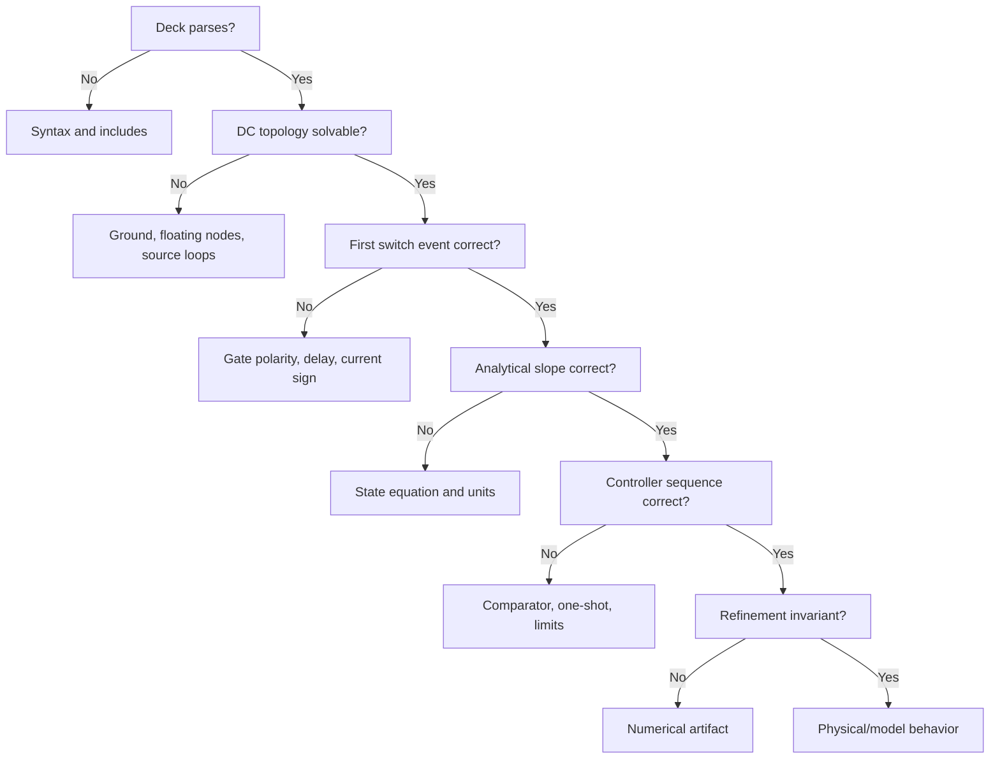

# PSpice debugging guide for switched buck models

Debug in layers. The first useful question is not “how do I make it converge?”
but “what is the earliest relationship that became false?” A converged solution
can still have the wrong sign, controller, abstraction, or timing.

The checked-in models have not yet been executed in Cadence PSpice. Current
status and risks are recorded in
[`pspice/validation-status.md`](../pspice/validation-status.md).

## 1. Freeze the evidence

Before changing a failing case, preserve:

- exact input deck and included libraries;
- PSpice version/hotfix and invocation;
- complete `.out` file;
- first reported warning/error, not only the final abort;
- `.OPTIONS`, maximum step, stop time, and initial conditions;
- a plot of gate commands, switch node, inductor current, output voltage,
  comparator request, trip, and ready/lockout state; and
- the smallest time interval that contains the first wrong event.

Changing five tolerances and three parasitics before preserving evidence destroys
the diagnostic trail.

## 2. Triage in this order



Do not jump to compensation tuning until the first switching event, slope, and
controller event order are correct.

## 3. Parser and syntax failures

Run the project structural check first:

```bash
python3 pspice/scripts/netlist_lint.py
```

It catches project-level mistakes, not PSpice grammar. For a PSpice parser error:

1. locate the first line number in `.out`;
2. join continuation lines mentally before reading the expression;
3. check brace and parenthesis balance;
4. confirm the subcircuit pin count and position;
5. reduce the expression to a constant, then add one operation at a time;
6. verify the function and element syntax in the target PSpice reference; and
7. record any target-release-specific change in `validation-status.md`.

Do not silently rewrite an ABM E/G source into another simulator’s `B` source
and call that PSpice validation.

## 4. Symptom-to-cause matrix

| Symptom | Likely cause | Discriminating check | Corrective action |
|---|---|---|---|
| Comparator chatters at one threshold | Zero hysteresis, excessive gain, ripple/noise, coarse event interpolation | Plot raw comparator input and request at sub-cycle scale; halve max step | Add justified `VHYST`, finite `VSOFT`, or filtering; retain the disclosed values |
| Timestep collapses at `t=0` | Ideal source/capacitor conflict, simultaneous switch state, impossible IC | Start controller disabled; inspect operating point and initial gate states | Add finite source/switch resistance or consistent IC; sequence startup |
| Singular matrix / floating node | Capacitor-only island, off switches isolate a node, missing ground path | Temporarily add a very large resistor and inspect connectivity | Add a physically justified leakage/return path and document it |
| “Converges” only with enormous `GMIN` | Discontinuous/ill-conditioned topology is unresolved | Compare waveform and operating point before/after GMIN | Repair topology or smooth the offending model; do not bless the altered result automatically |
| Output rises above VIN in an ideal buck | Wrong diode orientation, wrong current sign, both gates on, energy in initial state | Plot both gates and switch node; remove initial energy | Correct topology/sign and enforce break-before-make |
| Inductor current rises during normal low-side conduction | Inductor voltage sign or node order wrong | Compute `V(SW)-V(OUT)` at cursor | Correct element orientation or current sign convention |
| Current monitor is negative under normal load | Zero-volt sensor reversed or scaling sign wrong | Inspect `I(VILSENSE)` convention and KCL at output | Reverse sensor terminals or document intentional sign |
| Output droops when load is removed | Load-current sign reversed or controller feedback polarity wrong | Plot behavioral load current and error signal | Correct source direction or feedback summing sign |
| High and low gates overlap | Complement logic/delay error or too-coarse plotting | Plot `GHS`/`GLS` at full resolution; measure threshold crossings | Fix rise-delay/fast-fall network; reduce maximum step |
| Switch node goes slightly below ground in dead time | Positive-current low-side body diode | Correlate with positive `IMON` and both gates low | Usually physical within selected diode model; check magnitude |
| Switch node goes above VIN in dead time | Reverse-current high-side body diode | Correlate with negative `IMON` | Physical only if reverse current/energy supports it |
| Multiple phases fire together | Free-running requests, permit overlap, missing lockout, timing skew | Plot raw request, permit/grant, and gate separately | Add/repair scheduler or minimum separation; do not hide collision in output plot |
| A phase never fires | Fixed priority starvation, missing token advance, current trim saturated, phase disabled | Plot denied signal/token/permit/trim/active state | Repair fairness logic or state; bound and reset stale trims |
| Equal phase timing but unequal currents | L/DCR/sense/timing mismatch; no balance mechanism | Disable sense mismatch, then physical mismatch separately | Add verified low-bandwidth balance; timing alone is not sharing |
| Balance loop creates slow oscillation | Wrong trim polarity or excessive balance gain/bandwidth | Open balance loop; inject a trim step; compare with voltage loop | Correct polarity; reduce gain/BW and analyze coupled loops |
| Phase re-entry causes current spike | Returning phase starts at stale/zero state without controlled ramp | Plot phase current, `ACTIVE2`, request, gate | Ramp authority/reference, reset trim, or delay eligibility |
| Current limit does not stop pulse | Sense gain/polarity wrong, threshold units wrong, blanking stuck, abort path absent | Force a known sense voltage above limit | Correct scaling and confirm `TRIP` reaches `INHIBIT` |
| Current limit chatters | No hysteresis/filter, switch noise in sense, immediate rearm | Plot sense and trip; inspect `READY`/min-off | Add justified filter/hysteresis/blanking/min-off |
| Pulse is shorter than `TON` without trip | Permit incorrectly gates active pulse rather than only request; timer error | Plot timer/request/gate and permit | Gate the start request, not the active gate; measure one-shot timing |
| Pulse is longer than `TONMAX` | Command clamp not applied or timer discharge current wrong | Plot `TONMON`, internal timer if exposed, gate width | Fix command units/clamp and timer current expression |
| Frequency is unexpectedly fixed in COT | External windows dominate timing or ripple crossing repeats synchronously | Disable windows in single phase and inspect requests | Label scheduler constraint; do not infer universal COT frequency |
| Frequency is highly irregular | Insufficient ripple, wrong ripple phase, noise, delay, coarse step, genuine pulse skipping | Run zero noise; increase ripple; halve step separately | Identify the causal axis; do not call every irregularity instability |
| Alternating peak currents | Sampled-data current-mode behavior, missing slope compensation, or timestep alias | Compare cycle map at two steps and with/without ramp | Use an appropriate discrete model; derive criterion for stated assumptions |
| Averaged and switched models disagree near FSW | Averaged model used outside its bandwidth/domain | Compare only cycle averages below valid range | Use switched or sampled-data model for high-frequency behavior |
| Smaller timestep changes mean output materially | Event interpolation or numerical instability | Halve again and compare event sequence | Treat previous result as unconverged; inspect discontinuities |
| Smaller timestep reveals faster ringing | Parasitic LC was under-resolved | Estimate resonance from L/C and compare | Use appropriate step and damping; decide if parasitics are physical |
| Huge iteration limit eventually converges | Underlying discontinuity/topology may remain wrong | Inspect warning chronology and invariants | Fix root cause before raising limits permanently |

## 5. Debug the first switching period

Disable slow distractions:

- replace dynamic load with a fixed resistor/current;
- use fixed VIN and reference;
- disable noise, mismatch, balance, and phase shedding;
- run one phase;
- use a forced PWM pulse before closing the controller; and
- shorten stop time to a few periods.

At each interval, record:

| Interval | GHS | GLS | Expected `SW` | Expected sign of `diL/dt` |
|---|---:|---:|---:|---:|
| High-side | 1 | 0 | near VIN minus channel drop | positive if VIN > VOUT + loss |
| Dead time, positive current | 0 | 0 | near `-VF` | negative |
| Low-side | 0 | 1 | near ground plus channel drop | negative for positive VOUT |
| Dead time, negative current | 0 | 0 | near `VIN+VF` | generally positive toward zero |

If this table fails, do not close the voltage loop.

## 6. Distinguish physical instability from a numerical artifact

An oscillation is more credible as model behavior when:

- frequency/amplitude converge under timestep refinement;
- it persists with reasonable tolerance changes;
- energy has a physical storage path;
- its timing correlates with control events or an estimated resonance;
- it responds in the predicted direction to damping, ramp, or gain changes; and
- it appears in more than one valid abstraction where expected.

It is more likely numerical when:

- frequency tracks maximum timestep;
- polarity flips after a solver option change;
- it appears only at an ideal discontinuity with no physical energy storage;
- amplitude grows without a power source or conservation path;
- it disappears after adding tiny numerical smoothing but no physical dynamics;
- event order changes when Probe data compression/display settings change; or
- it exists in an averaged trace labeled as switching ripple.

Use quantitative comparisons. “Looks smoother” is not evidence.

## 7. Algebraic loops

An algebraic loop occurs when behavioral outputs depend instantaneously on one
another with no state or finite impedance that lets the nonlinear solve settle
to a unique physical point. Common examples:

- comparator output directly changes the threshold that generates that same
  output;
- ideal duty source depends on output, which depends instantaneously on duty;
- two ideal controlled voltage sources drive the same node; and
- latch equations reference each other without delay/state.

Break the loop by modeling the missing physics:

- comparator propagation state;
- finite output impedance;
- an explicit capacitor/latch state;
- controlled slew; or
- a well-defined event transition.

Do not insert an arbitrary delay solely to make convergence happen and then
forget it. Delay changes control behavior and must be a named parameter.

## 8. Initial conditions and startup

Startup is a test, not a nuisance to bypass. Still, debug it separately from the
steady-state controller.

Use three cases:

1. **Cold physical start:** `VOUT=0`, `iL=0`, controller reset.
2. **Initialized steady-state check:** capacitor near target and inductor near
   load/phase; used to inspect ripple without waiting for startup.
3. **Contradictory IC challenge:** intentionally wrong energy to verify clamps
   and recovery; never use this as the primary performance result.

The supplied closed-loop decks keep `REF=0` through 5 µs and ramp to target by
6 µs. This creates a quiescent pre-enable operating point for the behavioral
controller. Static decks use passive loads; incremental ideal-current loads are
zero at startup, and the capstone makes its load enable explicit. An ideal
constant-current sink active at `VOUT=0` can force negative output/current or
an artificial powered DC solution, so it is not a neutral startup choice. If
you remove the ramp or load gating, explicitly choose and document how PSpice
initializes timer, lockout, comparator-delay, inductor, and output-capacitor
states. Do not depend on an accidental DC solution of an active oscillator.

An ideal voltage source fixing a node and a capacitor with a different IC can
create an impulse-like conflict. State whether PSpice computed an operating
point or skipped it. Record every `UIC`-like choice if later introduced.

## 9. Comparator and one-shot isolation fixture

Before connecting a COT controller to a power stage, drive it with synthetic
signals:

- `FB` ramping slowly through `REF`;
- zero and then finite `RIPPLE`;
- a known `ISENSE` step below/above limit; and
- a known on-time command.

Measure:

- rising and falling comparator thresholds;
- request 50% to gate 50% delay;
- gate width at 50%;
- gate fall after current-limit trip;
- ready reassertion after gate fall; and
- retrigger behavior when request stays high.

If these are timestep-dependent, the controller is not ready for the plant.

## 10. Multiphase scheduler isolation

Replace all phases with event counters or gate probes. Apply synthetic request
patterns:

- all phases request simultaneously;
- only phase 2 requests;
- phase 1 requests continuously while phase 2 requests intermittently;
- request arrives just before/after a permit edge;
- current-priority inputs are equal, slightly unequal, then reversed; and
- a phase disables while it has a pending request.

Required invariants:

- at most the allowed number of grants in one separation interval;
- no grant to a disabled phase;
- every grant corresponds to a request;
- denied/delayed events are observable;
- round-robin token advances under the documented rule; and
- bounded waiting for any continuously eligible phase when fairness is claimed.

The supplied `FIRST_ELIGIBLE_2` intentionally violates a fairness guarantee so
starvation can be demonstrated.

## 11. Convergence workflow

Cadence documents solver and automatic-convergence controls in the
[*PSpice A/D User Guide*](https://resources.pcb.cadence.com/i/1180526/437)
(`CAD-PSPICE-UG`, accessed 2026-08-08). Use this order:

1. fix parser/topology errors;
2. shorten to the first failing event;
3. replace the controller with forced gates;
4. replace detailed switches with finite-resistance ideal switches;
5. ensure every dynamic/floating node has a physical DC path;
6. replace one hard discontinuity with documented finite `VSOFT`;
7. reduce maximum step around the event;
8. inspect device/model parameter scale;
9. alter one tolerance/iteration option at a time; and
10. reintroduce blocks one at a time.

Automatic convergence can identify sensitivity, but preserve both pre- and
post-change logs. If it changes GMIN, source stepping, or tolerances, rerun with
an understood permanent model/option choice before validation.

## 12. Unit traps

SPICE suffixes and control-signal scaling cause quiet failures:

- `M` traditionally means milli; use `MEG` for mega when portability matters.
- `IMON=1 V/A` means a 5 V monitor represents 5 A, not 5 V at the power node.
- `TONMON=1 V/s` means microsecond commands appear as microvolt-scale nodes.
- DCR and ESR are ohms; `10m` is 10 milliohms.
- `PULSE` widths/delays are seconds.
- Current-source direction is from its first node to its second.
- `I(COUT)` sign follows the device’s listed terminal order, which may differ
  from the conceptual capacitor-current sign.

Add a monitor source with an explicit equation if a Probe trace sign is
ambiguous.

## 13. Incorrect “fixes” to reject

- Shrinking timestep until a waveform looks attractive without a convergence
  comparison.
- Raising iteration limits until the run finishes without finding the first
  wrong event.
- Adding large hidden capacitance to every comparator node.
- Removing body diodes to avoid dead-time convergence.
- Forcing perfect phase currents instead of modeling balance.
- Replacing a current-limit trip with a precomputed duty clamp.
- Calling fixed PWM pulses a validated COT loop.
- Inferring PSpice compatibility from another SPICE engine.
- Using an averaged model to “confirm” cycle jitter.
- Treating one matched load-step waveform as full validation.

## 14. Minimal debug report template

```markdown
### Failure ID

- Deck / commit:
- PSpice version:
- First failing time:
- First warning/error:
- Expected state/event:
- Observed state/event:
- Analytical check:
- Smallest reproducer:
- Timestep refinement result:
- Root cause:
- Corrective change and physical justification:
- Regressions run:
- Remaining uncertainty:
```

When the blocks pass in isolation, return to the
[modeling guide](PSPICE_MODELING_GUIDE.md) and proceed through the
[capstone guide](CAPSTONE_GUIDE.md) without skipping stages.
